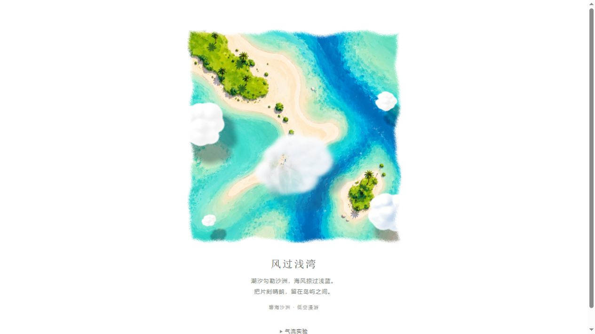
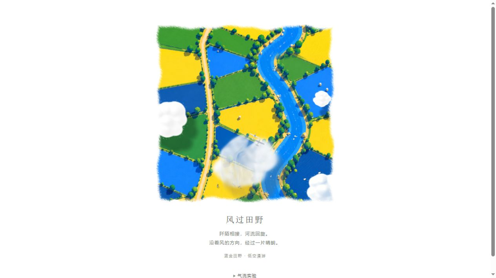

# 田野之间 · Between Fields

四幅会流动的俯视风景。以原比例绘画地景为底，叠加飞机、独立云影、水面与动物动画；穿云场景使用保存密度和速度状态的 GPU 尾流。

**[在线预览](https://luoban25.github.io/between-fields/#islands)** · **[下载四景完整版](https://github.com/luoban25/between-fields/releases/latest)** · [版本记录](CHANGELOG.md) · [素材处理记录](docs/islands-asset-v23.md)



## 四幅作品

| 作品 | 场景表现 |
| --- | --- |
| 草原河流 | 河流、牧群、飞机与平稳漂移的白云；牛羊独立行走。 |
| 蓝金田野 | 蓝、金、绿田块与河流；独立牧群、云面投影和持续穿云尾流。 |
| 赤土荒野 | 赤土地、灌木、干河床与小型越野车；具有时间记忆的穿云扰动。 |
| 碧海沙洲 | 棕榈、沙洲和蓝绿海水；水域光斑、反光、岸边白浪与穿云尾流。 |

页面使用纯白背景、不规则颗粒方框和中文介绍。顶部按钮切换作品，每次只运行当前场景。

## 在线预览

直接打开 **https://luoban25.github.io/between-fields/**，默认显示碧海沙洲，顶部可切换四幅作品，无需下载或登录。

网站由GitHub Pages托管，发布内容来自`dist/`，使用`gh-pages`分支。修改场景源码后需要同步更新发布分支。

## 最快打开

下载 Release 中的 ZIP，解压后双击：

```text
delivery/田野之间-直接打开.html
```

四幅作品的代码和图片已内嵌，不需要联网或安装 Node.js。重复图片共享存储，完整离线 HTML 约 28 MB。离线文件随 Release ZIP 提供，源码仓库保留重建脚本。请使用支持 WebGL2 的新版 Chrome 或 Edge。

## 本地开发

安装 Node.js 后，在项目目录运行：

```sh
npm run dev
```

打开 `http://127.0.0.1:5216/`。Windows 也可以双击 `start-preview.cmd`。

开发服务器使用 Node.js 标准库，启动预览不需要先安装依赖。重新打包离线网页时运行：

```sh
npm install
npm run build:offline
npm run check:offline
```

## 交互

- 顶部切换四幅作品，URL 哈希支持 `#pasture`、`#patchwork`、`#wilderness`、`#islands`。
- 聚焦画布后按空格暂停或继续，页面隐藏或场景离屏时暂停计算。
- “气流实验”提供暂停、重新飞越、飞行速度、尾涡强度、云浓度、环境风速、尾迹持续及衰减控制。
- 可查看完整画面、原始云体密度、空气流向和尾涡影响区域。
- v24 的控制面板在宽屏左侧留白区；窄屏靠左排在画面下方。

## 技术实现

HTML、CSS、JavaScript、Three.js r180、WebGL2、GLSL；原生页面无需前端框架。

地景与飞机采用 2.5D 正交分层展示。中央穿云云团采用体积光线步进，并按飞机高度分成前后云层，逐像素表现遮挡与云面投影。

云体状态由 **12 层 192×192 网格**构成，打包为 GPU 纹理图集。速度和密度通过双缓冲保留上一帧结果，结合半拉格朗日平流、涡量约束和解析翼尖尾涡注入，使飞机离开后的云体扰动继续运动、扩散和衰减。

这是分层数值输运与解析尾涡结合的实时视觉近似，尚未进行完整空气动力学 CFD 验证。边缘云采用固定种子生成并缓存的纹理；海水效果通过颜色掩膜限制在水域，保持海岸线和地景稳定。

## 目录

```text
dist/                    网页源码、GLSL、运行素材和本地 Three.js
  works/pasture/         草原河流
  works/wilderness/      赤土荒野及共享体积云、尾流、控制模块
  works/islands/         碧海沙洲与独立海水 Shader
  main.js / scene.html   蓝金田野
delivery/                离线文件说明；HTML由脚本生成或从Release获取
docs/                    素材记录与预览图
sources/                 参考素材
tools/                   离线打包和检查工具
server.mjs               本地静态服务器
```

## 验证与来源

```sh
npm run check
node tools/check-motion.mjs
node tools/check-cloud-volume.mjs
npm run check:offline
```

GPU 状态检查页源码为 `tools/flow-check.html`：临时复制到 `dist/flow-check.html` 后通过本地服务器打开，可检查实际反馈纹理中的持续扰动、衰减、暂停与重置。检查后移除临时页面。

场景来自项目提供的参考图与分层制作。海岛底图通过内置 ImageGen 清理固定云团及云影，提示词与文件位置见素材记录。Three.js 与 ImprovedNoise 的出处及 MIT 许可保留在 `dist/vendor/CLOUD-NOTICES.md` 和 `dist/vendor/THREE-LICENSE.txt`。


